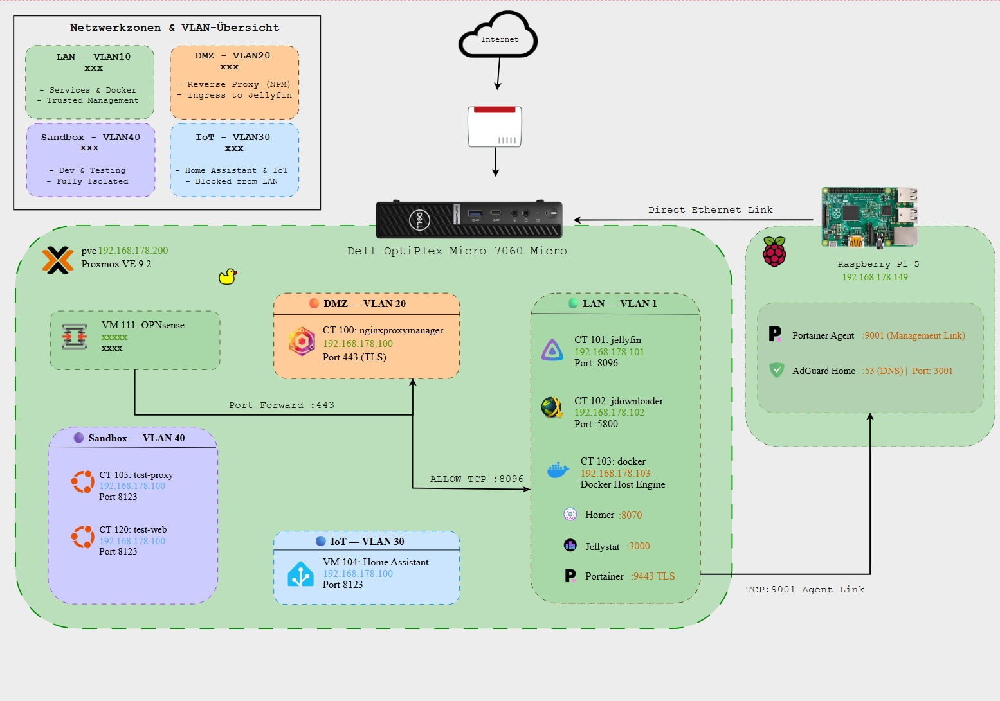

# 🏢 Home-Lab Infrastructure & Network Architecture

A documentation of my dedicated home-lab environment designed for practical implementation of **network segmentation (VLANs)**, **firewall policies**, **virtualization**, and **homelab services**.

---

## 🗺️ Network Topology

---

## ⚙️ Hardware Infrastructure

| Host / Node | Hardware Specs | OS / Hypervisor | Role / Workloads |
| :--- | :--- | :--- | :--- |
| **Primary Node** | Lenovo ThinkCentre M720q (Intel Core i5-8500T, 6C/6T) | **Proxmox VE 9.2** | Virtualization Host, OPNsense Firewall/Router (VM 111), LXC Containers & Docker VMs |
| **Edge & Uplink** | AVM FRITZ!Box (`192.168.178.1`) | FRITZ!OS | WAN Gateway, Upstream Internet Router |
| **Storage & Edge Node** | Raspberry Pi 5 (`192.168.178.149`) | **Linux** | Lightweight Edge Services, File Storage & Network Shares |
| **Virtual Switching** | Linux Bridge (`vmbr0`) & Virtual Interfaces | Proxmox / OPNsense | IEEE 802.1Q VLAN Tagging (`vtnet0`–`vtnet4`) & Inter-VLAN Routing |

---

## 🛡️ Network Segmentation & Security Zones

The internal network is segmented into isolated broadcast domains using strict stateful firewall policies and RFC 1918 filtering:

| Interface / VLAN | Subnet | Gateway | DHCP Range | Zone Name | Description & Security Policy |
| :--- | :--- | :--- | :--- | :--- | :--- |
| **WAN** (`vtnet0`) | `192.168.178.0/24` | `192.168.178.1` | Static (`.140`) | **WAN Uplink** | Upstream link to FRITZ!Box. Dedicated HTTPS rule configured for secure Web-GUI administration. |
| **LAN / VLAN 10** (`vtnet1`) | `10.0.10.0/24` | `10.0.10.1` | `.10` – `.245` | **Trusted LAN** | Admin workstations and trusted clients. Full access to WAN and unilateral routing to isolated segments. |
| **VLAN 20** (`vtnet2`) | `10.0.20.0/24` | `10.0.20.1` | `.100` – `.200` | **DMZ** | Public-facing services & reverse proxies (Nginx Proxy Manager). Isolated from internal networks. |
| **VLAN 30** (`vtnet3`) | `10.0.30.0/24` | `10.0.30.1` | `.100` – `.200` | **IoT** | Smart-home infrastructure (Home Assistant, bridges, IoT endpoints). Internet access allowed; RFC 1918 denied. |
| **VLAN 40** (`vtnet4`) | `10.0.40.0/24` | `10.0.40.1` | `.100` – `.200` | **Sandbox** | Ephemeral testing environments, malware/script analysis, and lab experiments. Zero lateral movement. |

---

## 📌 Roadmap & Future Enhancements

- [x] Hypervisor-level VLAN tagging and network bridge configuration
- [x] OPNsense multi-interface routing and isolated DHCP pools
- [x] RFC 1918 firewall isolation matrix and container verification
- [x] Migration of existing workloads (Nginx Proxy Manager to DMZ, Home Assistant to IoT, Jellyfin to LAN)
- [ ] Centralized DNS sinkhole via AdGuard Home
- [ ] Centralized log aggregation and telemetry (Grafana / Prometheus / Syslog)
- [ ] Implementation of a SIEM solution for intrusion detection (Wazuh / CrowdSec)
